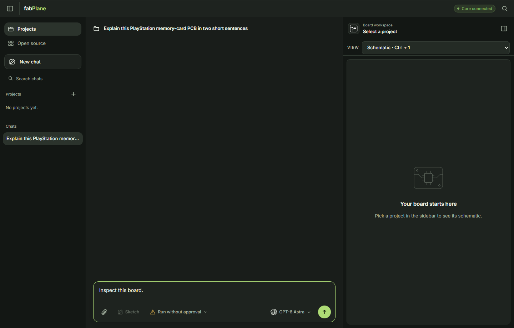
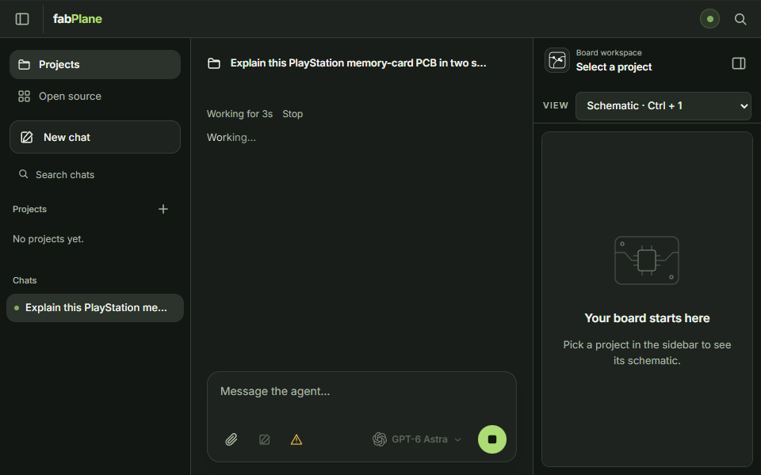

# Composer cleanup

Capture source: 771dca2d19d590a67c7d21b0ee7b5c210be6b5d6. Real AppShell components with isolated mock data, captured in Windows Edge Chromium at 1440 x 920 and 960 x 600. No agent runs were started.

- Removed the visible keyboard-hint footer. Enter sends/queues; Shift+Enter still inserts a line.
- One circular composer action: up arrow sends, square stops an active run with an empty draft, queue arrow queues a typed follow-up. A small Stop action beside live activity remains available while drafting. Queued messages remain scheduled after stopping.
- Model labels use the selected model, FabDesk agent setting, then reported agent default. Codex detection now reads its home config and selected profile model without modifying configuration. Unknown defaults say Choose model. This is configured-model metadata, not telemetry proving which model served a turn; project/session/provider overrides are not resolved here.

Verification: UI and agents typecheck passed; 116 UI tests passed; desktop build passed. Browser checks at both sizes passed: circular control, resolved model, send/queue/stop requests, disabled in-flight submission, retained draft/attachment on failure, clearing only after acceptance, Shift+Enter/Enter, stop failure feedback, and no horizontal document overflow. The actual desktop was opened and verified to show GPT-6 Astra, no footer hints and the new send control.

Agents: 74 passed / 8 failed. All eight failures reproduced with the unchanged HEAD adapter restored temporarily: three owner/process recovery tests, Codex isolation, privileged Windows symlinks, Windows CLI fixture execution, and two shared-auth symlink tests. All three new model metadata tests passed. Full root suite and physical macOS checks were not rerun for this change.

