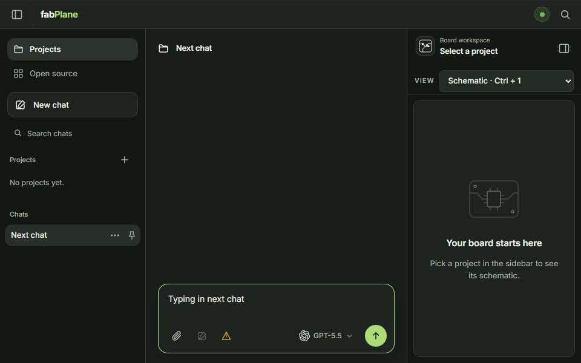

# Typing after chat deletion

Source 50ba4dec8cb65318fa1f4e1169cbdcaa69354947. Replaced blocking native window.confirm with the existing in-app Dialog. Wait for successful deletion before changing the active chat; retain its project and focus the composer after dialog teardown. Failed deletion keeps the dialog, current chat and draft for retry. Cancellation sends no delete request.

Windows Edge AppShell fixture at 960 x 600 passed: cancellation, injected deletion failure, retry, immediate keyboard typing after deleting the active chat, selecting another chat and typing there, and zero native confirm dialogs. Screenshot uses disposable mock chats. UI typecheck, 123 UI tests and desktop build passed; actual desktop refreshed. No real chats were deleted. The original Windows native-dialog keyboard lock was reported by the user, not reproduced in the browser fixture; the test verifies the replacement path. Physical macOS not rerun.

