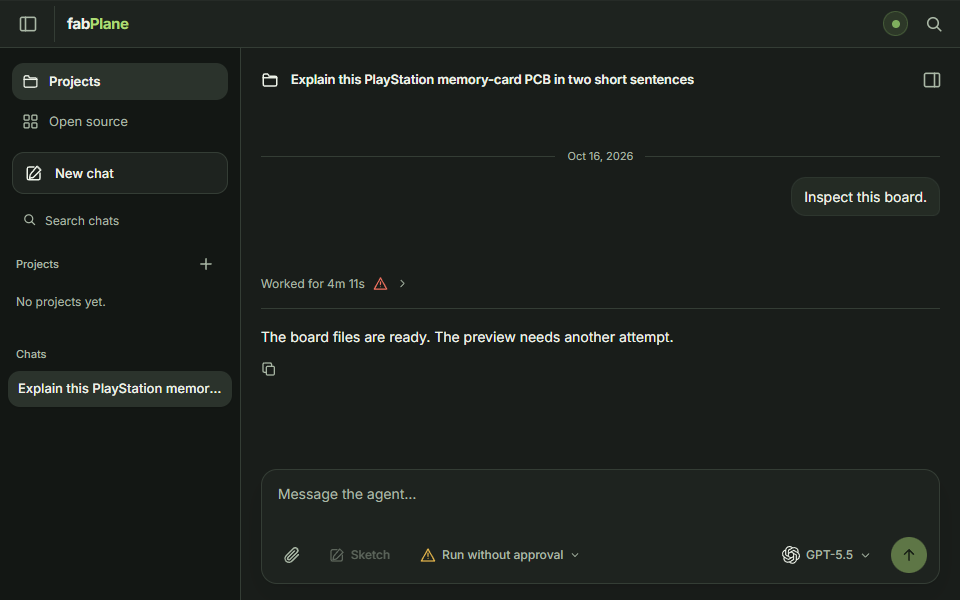
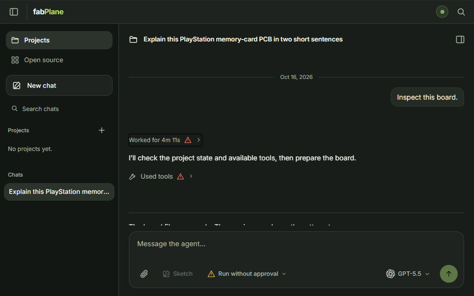

# Folded completed activity

Source 4e0e039067bc41a0c32f445c69fe84e1ac3e237a. Actual AppShell with mock data in Windows Edge; checked at 1440 x 920 and 960 x 600.

Completed assistant messages in the same contiguous run fold their progress and tools under Worked for. The trailing text/image answer stays outside, below the divider. While running, activity remains visible. A warning on the summary exposes errors without expanding; details remain available inside. Keyboard expansion works, and message search opens a containing history disclosure before scrolling.

Persisted duration is available for the latest run only. Older runs show Worked without invented timing. The current protocol has no final-answer phase: the splitter preserves the trailing text/image parts after the last tool/thinking step. Plain text is kept intact rather than guessing sentence boundaries. Failed/stopped runs keep their content in history and display their outcome; no final answer is fabricated. Legacy messages without a run ID remain ungrouped.

Passed: UI typecheck, 123 UI tests, desktop build, both-size browser checks for collapsed/expanded state, final answer, warning, keyboard, search and overflow. Desktop refreshed. No paid runs. Physical Mac not rerun.

