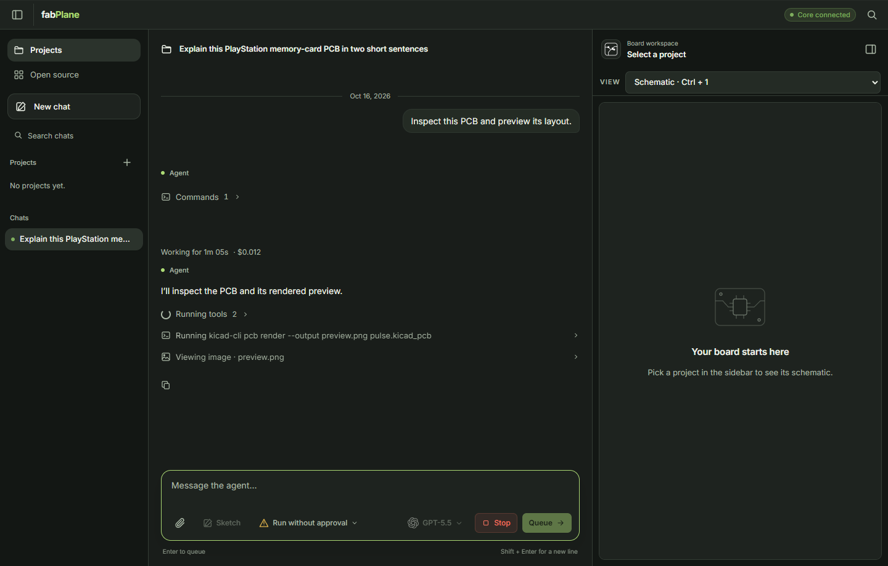
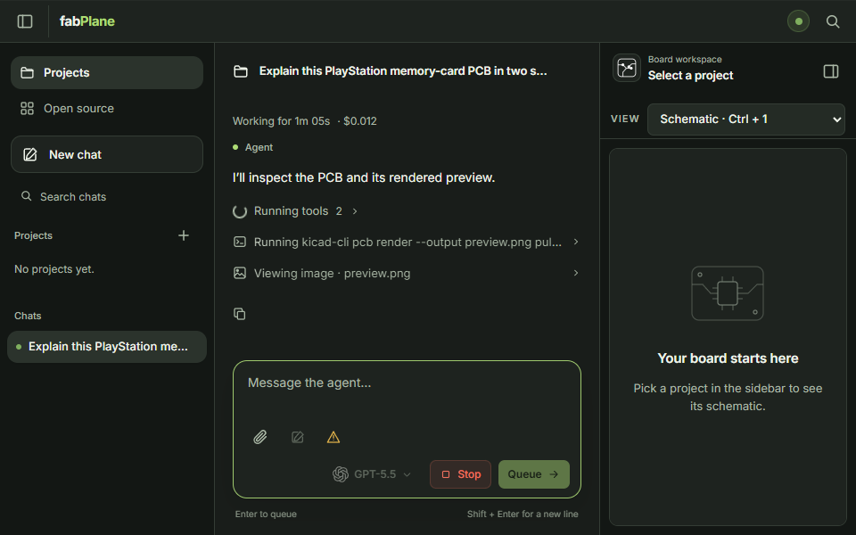

# Inline live activity

Capture source: 5ac23dd63d377f06ee3ee8c6a090a6d7e7d31ff3. Actual AppShell with isolated mock messages/run state, captured in Windows Edge Chromium at 1440 x 920 and 960 x 600. No paid agent runs were started.

- Removed running/time/cost from the chat header. Timing, cost, and token tooltip now sit beside the active conversation response.
- Active command/tool steps remain visible when their group is collapsed. Explicit image-view steps show Viewing image / Viewed image and a dedicated icon.
- Current activity has a gentle 2.6-second left-to-right text shimmer. Completed/failed/stopped work stays static. Approval/input waits stay static. Reduced-motion and forced-colors modes keep ordinary text.
- Live activity matches message run IDs; an unfinished call from an older run is never animated as new work.

Verified at both sizes: inline timing/cost, no header running badge, collapsed active commands/images, all four themes, reduced motion, keyboard expansion, completion, image failure, approval wait, stop, and document overflow. UI typecheck, 116 UI tests, and desktop build passed. Physical Mac was not rerun.

Image reporting is limited to explicit tool events supplied by the connected agent (view_image, image_view, open_image, including namespaced tools). Rendered images alone do not prove an agent viewed them. No parser, backend, or protocol changes are included; image-view operations omitted by an agent's event stream cannot be displayed by this UI.

