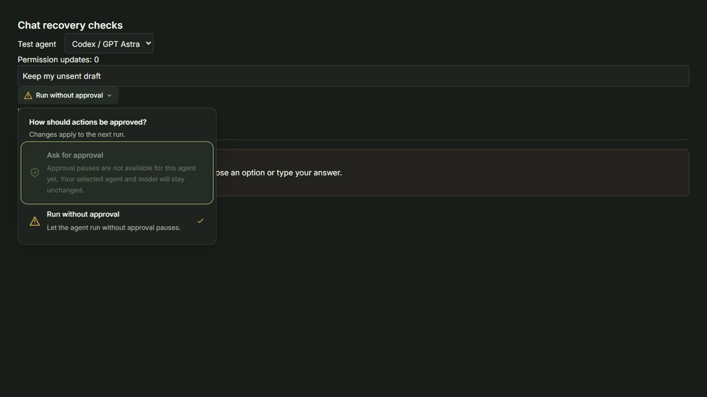
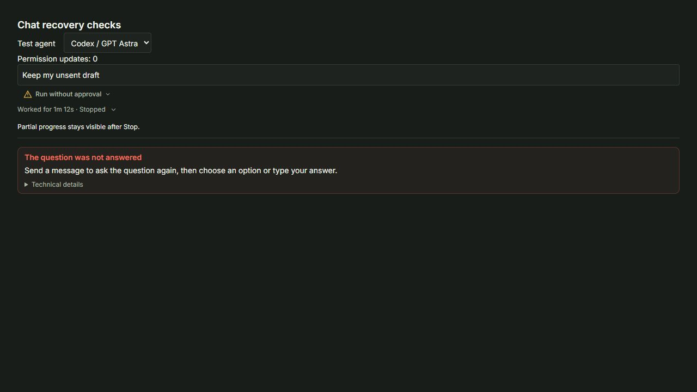

# PR #344 review repairs — October 19, 2026

- Stop waits for the Codex transport to exit; POSIX shutdown escalates for a process ignoring SIGTERM.
- Separate native question batches share one interrupt/resume cycle. Missing answers show recovery guidance, secret batches open no cards, and failures cancel sibling cards.
- Public reasoning summaries stream and persist without duplicating the final summary or exposing private reasoning content.
- Approval choices follow the selected agent's reported capabilities. Unsupported choices leave the agent/model untouched; the backend returns a specific recovery code.
- Failed/stopped runs and unanswered questions start expanded. Error notices subscribe only to the actions they need; ordinary assistant diagnostics stay as prose.
- Run history uses an indexed UNION, retaining parent-run timing in branched chats.

## Verification

341 focused UI/client-core/core/agent tests passed; one POSIX-only SIGTERM escalation test is skipped on Windows. All five affected package typechecks and the desktop production build passed.

A real installed Codex app-server session with GPT Astra and the automatic reviewer completed a harmless shell command, displayed a native question, accepted `56`, and finished successfully in a temporary non-Git directory. The session was ephemeral and read-only. Command fields matched the generated v2 protocol; synthetic tests also cover file/MCP/web tool items.

Browser checks used real components with a disposable mock client, not user chats: an unavailable Codex approval choice ignored keyboard activation (zero updates); a supported choice saved once; the draft remained; Stop details started expanded. Screenshots below show that fixture. Native Codex approvals remain in separate PR #355.

Full-suite Windows limitations recorded in the earlier review remain: unchanged agent symlink/process fixtures and desktop JRE signing path assertions. They are not counted as passing here. Existing native window-zoom checks are in `../window-caption-sizing/`; shopping/question captures are in `../shopping-questions-feedback/`.
