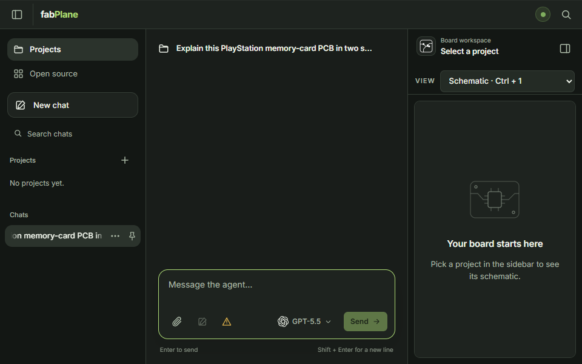

# Sidebar title fades

Capture source: 144a9a00e0660c7a9568d9dff6f7012d73c9fb6f. Actual UI components with mock API data in Windows Edge Chromium; scrolling animations paused at their midpoint for screenshots.

Overflowing project/chat titles fade at the edges while scrolling on hover or keyboard focus. The leading edge stays clear at the start; the trailing edge clears at the end. Short titles and reduced-motion ellipsis remain unchanged. Masks use transparency, so they follow all four themes and selected/hover backgrounds.

Also constrained the standalone Chats grid to the sidebar width: long names previously stretched its rows beyond the visible pane.

Verified at 1440 x 920 and 960 x 600: fade start/middle/end, all four themes, keyboard focus, reduced motion, short names, and no horizontal document overflow. Desktop build passed. Physical Mac was not rerun.

