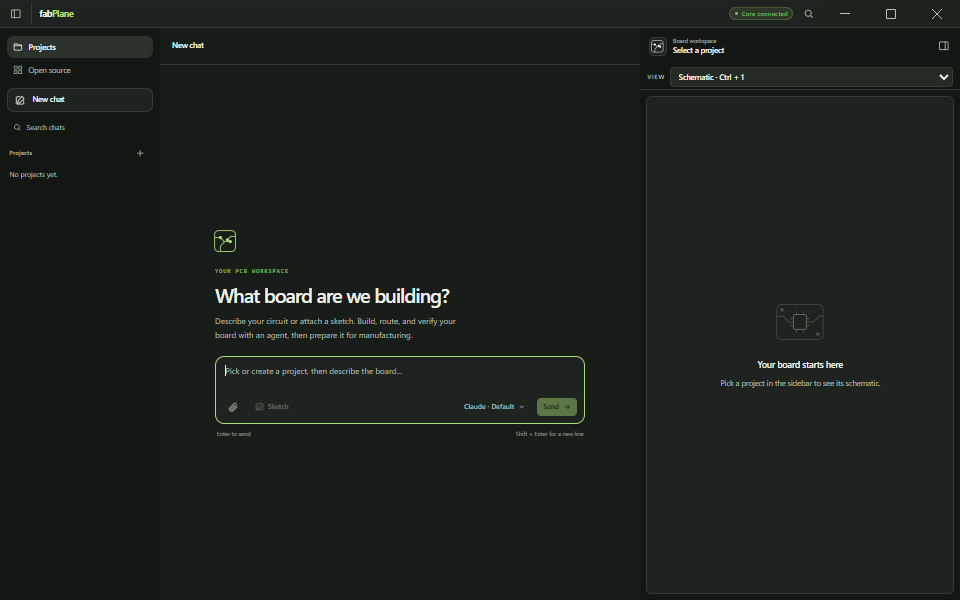
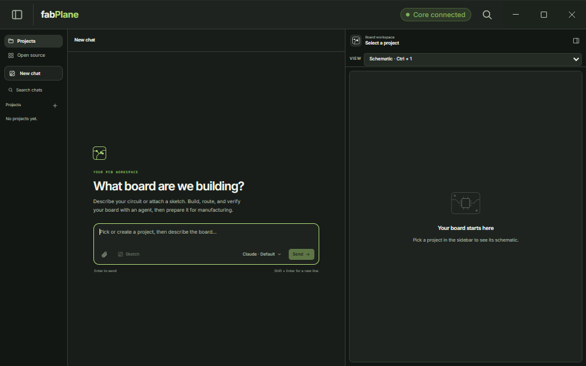

# Consistent Windows chrome

Before: `363e4b1` (same caption implementation as main `6ddbfa2`).
After: `49bd9c1673d5f94857d0d8c2c8d92533b2d7600b`.

The toolbar previously shrank with page zoom while Windows caption glyphs stayed fixed. Now the Windows top bar stays 48 DIPs high and its toolbar SVGs stay 20 DIPs wide. Workspace content still zooms. Native caption controls and macOS traffic lights are retained.

Electron only exposes caption height and colours, not glyph size: [API documentation](https://www.electronjs.org/docs/latest/tutorial/custom-title-bar). Its Windows caption painter sizes glyphs independently of page zoom: [source](https://github.com/electron/electron/blob/main/shell/browser/ui/views/win_caption_button.cc).

## Actual Windows captures

960 x 600 native Electron 44.1.1 test window, 57.87% workspace zoom, actual TopBar/AppShell components and isolated mock API data. Includes native caption controls; no backend or paid agent runs. These are component integration checks, not a signed installer test.

| Before | After |
| --- | --- |
|  |  |

## Verification

- Root typecheck passed; desktop typecheck rerun after the final animation-frame scheduling change passed.
- Desktop build passed; 110 UI tests and 5 native-theme tests passed.
- Actual Electron zoom checks at 50%, 57.87%, 83.33%, 100%, 120%, 144%, 200%, then reset: toolbar height stays 48 DIPs and toolbar SVG width stays 20 DIPs, with no overlap into native controls.
- Repeated using Electron's 125% device-scale override; passed. This is not a multi-monitor hardware test.
- Minimize, maximize, unmaximize, restore and close completed in the disposable Electron window. Snap Layouts were not interactively rechecked; the native controls implementation is retained.
- No physical Mac rerun; the compensation applies only to Windows desktop. Full backend tests and signed installer testing were not repeated.

Geometry JSON uses renderer CSS coordinates; multiplying height/width by actualZoom gives DIPs. The native caption exclusion rectangle was checked separately on every zoom step.
