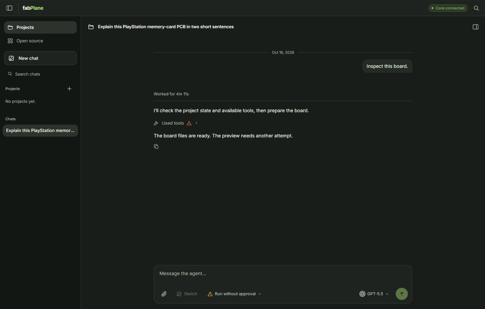
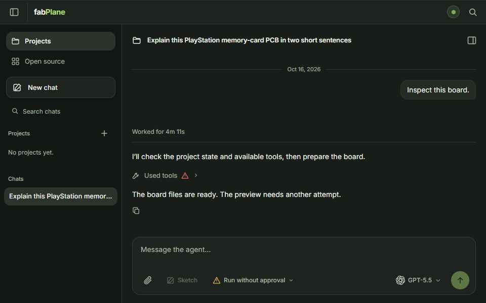

# Finished activity

Source: de803ab7f43ce9b4f970baa549ae94fc75fb2ff7. Windows Edge AppShell fixture, mock completed run, 1440 x 920 and 960 x 600.

- Removed the Agent label and green dot.
- Working/Worked for duration sits above the reply with a subtle bottom divider.
- Completed duration uses saved start/end timestamps; invalid or missing timing is omitted. Failed and stopped runs retain their outcome label.
- Tool summaries have no counts. A red triangle marks an error; tooltip and accessible label explain it. Expand to inspect details.
- Completion refreshes the thread snapshot. The existing API provides only the latest run, so persisted Worked for summaries are limited to that run; older durations are not guessed.

Passed: 119 UI tests, 116 client-core tests, both package typechecks, desktop build, and browser checks at both sizes (duration/divider, labels, error icon, keyboard expansion, no document overflow). Refreshed the actual desktop. Physical Mac not rerun. No backend API changes or agent runs.

